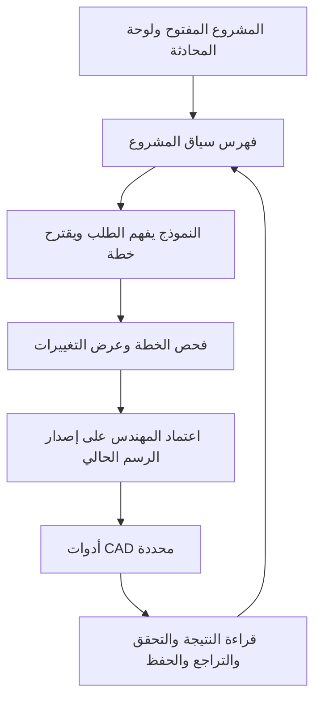

# Vibe Engineer — خطة التنفيذ v0.1

تاريخ الخطة: 17 نوفمبر 2026.

## الرؤية المتفق عليها

المهندس يفتح مشروعه الموجود في CAD، ويجد مساعدًا داخل بيئة العمل يستطيع قراءة سياق المشروع، الإجابة مع تحديد مصدر المعلومة على الرسم، والتخطيط لتعديلات وتنفيذها ومراجعتها والتراجع عنها. تبقى الرسومات ملفات CAD قابلة للتحرير.

المجال الأول: المباني الخرسانية لطلاب ومهندسي المدني. الشريحة التجارية الأولى التي سنختبرها: مكاتب تصميم إنشائي صغيرة. هذه فرضية سوق تحتاج تجربة مع مهندسين فعليين.

أوامر الأعمدة والترقيم والجداول حالات اختبار أولى لهذا المساعد. الرؤية تشمل العمل على مشروع قائم والتوسع إلى مهام أخرى بعد إثبات صحة التنفيذ.

## ماذا يعني فهم المشروع؟

- قراءة الملفات والرسومات المفتوحة، الوحدات، الطبقات، البلوكات وخصائصها، النصوص، الأبعاد، اللوحات والمراجع الخارجية المتاحة.
- بناء فهرس محلي يربط كل عنصر بمعرفه وملفه وإصدار الرسم ومصدر خصائصه.
- التمييز بين حقيقة مقروءة من الملف، وقياس محسوب، وتصنيف استنتجه المساعد، وتصنيف أكده المستخدم.
- استرجاع العناصر المناسبة عند كل طلب؛ لا حاجة لإرسال الملف كاملًا إلى النموذج كل مرة.
- تحديد مصدر الإجابة بصريًا: إجابة مثل «وجدت 18 عنصرًا مصنفًا كعمود» يجب أن تسمح بتحديد هذه العناصر وإظهار نطاق البحث.
- تتبع التعديلات اليدوية وتحديث الفهرس أو إبطاله قبل تنفيذ خطة قديمة.
- عرض الملفات أو المراجع المفقودة والعناصر غير المقروءة. لا تُعرض معرفة المشروع على أنها كاملة إذا كان جزء منه غير متاح.

ملفات CAD لا تحتوي دائمًا على معنى هندسي صريح. مستطيل مرسوم بخطوط قد يحتاج تأكيد تصنيفه من المهندس. لا نضمن استنتاج الأحمال أو العلاقات الإنشائية من هندسة الرسم وحدها.

## تجربة الاستخدام الأولى

1. يفتح المهندس لوحة موجودة في Open CAD Studio ويفتح لوحة المساعد.
2. يفحص المساعد الرسم ويعرض ملخصًا قصيرًا ونطاق المعلومات التي استطاع قراءتها.
3. يسأل المهندس عن عناصر أو طبقات أو مقاسات؛ تظهر الإجابة مع العناصر التي استندت إليها.
4. يحدد المهندس عناصر ويطلب تعديلًا واضحًا، مثل إعادة ترقيمها أو تغيير خاصية مدعومة أو مقاسات عناصر ذات تمثيل معروف.
5. يعرض المساعد العناصر المتأثرة والقيم قبل وبعد، ويطلب البيانات الناقصة قبل إعداد خطة التنفيذ.
6. يعتمد المهندس خطة مرتبطة بإصدار الرسم. تنفذ الأدوات التغيير، ثم تقرأ النتيجة وتتحقق منها.
7. يستطيع المهندس التراجع، وحفظ نسخة ثم إعادة فتحها للتحقق. الجداول أو الأبعاد المرتبطة تتحدث فقط حين تكون علاقتها بالمصدر مدعومة ومختبرة.

معاينة التغيير الأولى يمكن أن تكون تحديدًا للعناصر وجدول قبل/بعد. المعاينة الهندسية الدقيقة تحتاج نسخة مؤقتة أو آلية غير مدمرة نثبتها عمليًا.

## تتبع تأثير التعديل وإعادة التحقق — إضافة بناءً على توضيح المستخدم

يجب أن يتتبع المساعد آثار التغيير، ويصلح ما يمكن إصلاحه بأدوات وقواعد مثبتة، ويعرض ما يحتاج قرارًا هندسيًا. تغيير كمرة لا يعني تلقائيًا تغيير قطاع العمود؛ يعني إعادة تقييم العناصر والنموذج المتأثرين، وقد تثبت الحسابات صلاحية القطاعات الحالية.

نميز بين ثلاثة مستويات من العلاقات:

1. توثيقية: العنصر ووسمه وأبعاده وجدوله وكمياته. تُحدَّث العلاقات المعروفة وتُوسم النتائج القديمة بوضوح.
2. هندسية/مكانية: الاتصال والمناسيب والتقاطعات والفتحات والقيود. تفحصها أدوات هندسة الرسم ضمن النطاق المدعوم.
3. إنشائية: الأحمال والمواد والقطاعات والمساند والتحريرات والنموذج التحليلي والكود المستخدم. يلزم لهذه العلاقات محرك تحليل وتصميم مختبر وبيانات مؤكدة؛ ملف CAD وحده لا يكفي غالبًا.

دورة التعديل المستهدفة: حفظ حالة البداية → تحديد العناصر والعلاقات المتأثرة → إعداد تعديل تجريبي → إعادة الحسابات المطلوبة → فحوص محددة → اقتراح تصحيح ضمن قيود المهندس → إعادة التحقق → عرض الفروق ونتائج الفحص → اعتماد التغيير. حدود النطاق يحددها النموذج التحليلي؛ قد تتطلب تغييرات محلية إعادة تحليل المنشأ كله.

النموذج اللغوي ينظم الخطوات ويستدعي الأدوات. نتائج الحساب تأتي من محرك التحليل، والتحقق من أدوات مستقلة عن تقييم النموذج اللغوي لنفسه. لا يُغيّر المساعد الأحمال أو المساند أو المواد أو معيار القبول لكي يجعل الفحص ينجح.

تكون محاولات التصحيح محدودة العدد والتكلفة، ولكل محاولة سجل ومقارنة مع حالة البداية. عند نقص بيانات أو عدم التقارب أو تعارض القيود، يتوقف ويعرض السبب والنتائج المتبقية؛ لا يعلن نجاحًا عامًا. نتائج الفحوص مرتبطة بإصدار النموذج وإعدادات التحليل والكود، وأي تعديل مؤثر يبطل النتائج السابقة.

في النسخة الأولى ننفذ تحديثات الرسم والبيانات المرتبطة المدعومة، ونعرض أن أثر التعديل الإنشائي يحتاج تحققًا حين لا يتوفر محرك الحساب. التكامل مع محرك تحليل وتصميم مرحلة أساسية لتحقيق الرؤية الكاملة، لها اختبار مستقل على نموذج صغير معروف النتائج ومراجعة مهندس قبل توسيع الدعم.

## القرار التقني الأولي

نبدأ بخدمة Python محلية تتصل بلوحة Assistant الأصلية في Open CAD Studio، وتستخدم MCP لقراءة الرسم وتنفيذ أدوات محددة. تتصل الخدمة بـOpenRouter. هذا اختيار مبدئي يخضع لاختبار على إصدار مثبت.

توثيق المشروع يصف لوحة Assistant وخدمة محلية عبر TCP وJSON، وأدوات للاستعلام والتعديل والتحقق والحفظ والتراجع. قراءة التوثيق لا تثبت جاهزية العمليات المطلوبة على ملفاتنا. يجب تثبيت إصدار/commit معروف والتحقق من قدراته الفعلية؛ توثيق main قد يسبق الإصدار المنشور.

الطبقات المقترحة:

نحافظ على واجهة اتصال مستقلة بالمحرر حتى يمكن تقييم محرر آخر إذا لم تناسب Open CAD Studio ملفات العملاء أو طريقة عملهم. نراجع GPL وتراخيص المكونات قبل اختيار طريقة توزيع المنتج؛ الخدمة المنفصلة ليست حكمًا تلقائيًا على الالتزامات الترخيصية.

## مراحل التنفيذ ومعايير الانتقال

التقدير الأولي لتجربة مستخدم محدودة: 4–6 أسابيع عند توفر وقت منتظم وملفات اختبار مناسبة. هذا تقدير تخطيط، وتحدد نتائج المراحل مدته الفعلية. دعم مشروعات متعددة الملفات بصورة واسعة يأتي بعد هذه التجربة.

| المرحلة | العمل | الدليل المطلوب للانتقال |
|---|---|---|
| 0 — فهم الشغل وتجربة الاتصال | مقابلة 5 مهندسين، جمع أمثلة قبل/بعد بإذن أصحابها، وتجربة مستقلة على رسم مصطنع | وجود مهمة متكررة واضحة؛ ونجاح قراءة/تعديل/تراجع/حفظ/إعادة فتح على إصدار معروف |
| 1 — قراءة الرسم النشط | فهرسة الوحدات والعناصر والطبقات والبلوكات والنصوص والأبعاد واللوحات؛ إجابات قابلة للتتبع | تطابق نتائج البحث والعدد والمقاسات مع مرجع الاختبار؛ إظهار النطاق والعناصر غير المدعومة |
| 2 — تنفيذ موثوق | أدوات محددة، فحص مدخلات، خطة قبل/بعد، كشف تغير الرسم، تنفيذ وتحقق وتراجع | صحة العمليات المدعومة وبقاء العناصر خارج النطاق دون تغيير في مجموعة الاختبار |
| 3 — المحادثة والموديلات | فهم العربية والإنجليزية، استيضاح الغموض، استدعاء الأدوات وتحديد حدود الكلفة | نجاح متكرر في المهام المعلنة، والتوقف الصحيح عند غموض مؤثر أو عملية غير مدعومة |
| 4 — ملفات واقعية وتجربة مكتب | تشغيل المسار الكامل على ملفات مكتب، مقارنة بالطريقة الحالية، قياس وقت التهيئة والمراجعة | توفير وقت ملموس، قبول جودة الملف في أداة المكتب، واستخدام متكرر |
| 5 — توسيع سياق المشروع | فهرسة عدة رسومات ومراجع وربطها بمصادرها، ثم إضافة مهام يطلبها المستخدمون | نجاح البحث بين الملفات، التعامل الصريح مع المراجع المفقودة، والتحقق من أي تغيير عبر أكثر من ملف قبل تعميمه |

نبدأ هندسة الاتصال والاختبارات المصطنعة أثناء جمع ملفات المكاتب. لا يتوقف العمل المستقل على انتظار المقابلات، لكن اختيار المهمة التجارية النهائية يتطلب دليلًا من المستخدمين.

## العمليات الأولى وحدودها

- قراءة الرسم والبحث والتحديد والقياس مع مصدر ونطاق واضحين.
- تعديل خصائص عناصر محددة، مثل الطبقة أو النص أو سمات block، بعد إثبات الدعم.
- إعادة ترقيم مجموعة وفق ترتيب يحدده المستخدم وكشف تعارض الأرقام.
- تعديل مقاس أعمدة ذات تمثيل معروف وبمقاس صريح يقدمه المهندس، بعد إثبات صحة تغيير الهندسة والعناصر التابعة.
- توليد وتحديث جدول بسيط: معرف العنصر، المقاس، والعدد ضمن نطاق محدد. هذا الجدول لا يتضمن تصميم التسليح.

التوسع التالي يختار بناءً على طلبات العمل: المحاور، الأبعاد، الكمرات، الجداول، تجهيز اللوحات، أو مراجعة الاتساق. كل قدرة لها مدخلات مدعومة وحالات اختبار.

اختبارات لازمة: وحدات مم/سم/م، دوران العناصر، اختلاف مقياس البلوكات، طبقات مقفلة، إلغاء العملية، تكرار الطلب بعد انقطاعه، وتغير الرسم يدويًا أثناء إعداد الخطة. تعديل تعريف block مشترك يجب ألا يغيّر instances خارج المجموعة المطلوبة؛ نثبت العزل أو نرفض الحالة. الحالات غير المدعومة تُشرح للمستخدم.

مراجعة الملف بعد الحفظ تشمل المقاسات والمعرفات والعناصر المتأثرة وسلامة العناصر خارج النطاق ضمن مجموعة الخصائص المختبرة. نجاح تدقيق محرك CAD وحده لا يعني اعتماد التصميم الإنشائي أو ضمان حفظ كل أنواع بيانات CAD.

## اختبار النماذج والميزانية

المرشحان الأساسيان للاختبار: GLM 5.3 Flash وQwen3.8 Flash. Qwen3 Coder Flash مرشح ثالث إذا أظهرت النتائج حاجة له. الاختيار النهائي تحدده تكلفة المهمة الصحيحة وزمنها وجودة استخدام الأدوات على حالاتنا.

- نقسم 30 سيناريو إلى 20 للتطوير و10 للتقييم دون ضبط التعليمات عليها، مع تكرار كل سيناريو ثلاث مرات لكل نموذج ضمن سقف الإنفاق.
- تشمل الحالات أوامر عربية وإنجليزية، معلومات ناقصة، وحدات مختلفة، طلبًا خارج النطاق، وخطة أصبحت قديمة بعد تعديل يدوي.
- نقارن بصيغة أوامر مباشرة دون نموذج لنعرف مقدار التكلفة والوقت الذي يضيفه الحوار ومقدار الفائدة التي يقدمها.
- الكود المحلي يحسب الإحداثيات والكميات ويتحقق من القيود؛ النموذج يحدد المقصود ويختار عمليات محدودة.
- حد أقصى لعدد دورات الأدوات ومحاولات التصحيح، مع تسجيل إجمالي تكلفة كل مهمة بما فيه المحاولات الفاشلة. لا توجد حلقة إصلاح بلا سقف.
- مفاتيح API تبقى في إعدادات محلية مستثناة من المستودع، ويقتصر سياق النموذج على البيانات اللازمة للطلب.

| بند تجارب API | السقف المقترح |
|---|---:|
| تقييم الموديلات الأولي | $5 |
| تجارب المستخدمين بعد اجتياز التقييم | $10 |
| احتياطي من الرصيد الظاهر $92.06 | $77.06 |

لم تُنفذ طلبات API مدفوعة ضمن إعداد هذه الخطة. هذه حدود مقترحة لا تكلفة مؤكدة للمشروع؛ وقت التطوير ومراجعة الملفات جزء أساسي من التكلفة.

## كيف نقرر الاستمرار؟

- هدف مبدئي: نجاح 90% على الأقل من الطلبات المدعومة في مجموعة التقييم، مع كشف حالات الغموض المؤثر والعمليات غير المدعومة الموجودة في الاختبارات.
- أي تغيير غير مقصود خارج نطاق الخطة في الاختبارات يمنع إصدار تلك القدرة حتى إصلاحه.
- نسجل نسبة المهام الحقيقية التي نغطيها أيضًا؛ نجاح الحالات المدعومة وحده لا يكفي إن كانت نادرة في الشغل الفعلي.
- هدف تجربة المكتب: تقليل الزمن الوسيط للمهمة 50% بعد احتساب التهيئة والمراجعة والتصحيح، على مهام متقاربة التعقيد.
- دليل تجاري أولي: مهندسان يعودان لاستخدام الأداة في مهمة ثانية، ومكتب واحد يقبل تجربة مدفوعة بنطاق وتسليم واضحين. هذه أهداف اختبار وليست توقعات مضمونة.
- إذا نجحت التقنية ورفضت ثلاثة مكاتب مناسبة العمل داخل Open CAD Studio، نقيّم الاتصال ببرنامجهم الحالي أو معالجة نسخة قابلة للإرجاع، مع الحفاظ على تجربة المساعد داخل سير العمل كلما أمكن.
- إذا لم تتكرر المهمة لدى العملاء، نغير مجموعة المهام بناءً على أمثلة فعلية قبل توسيع المنتج.

## توزيع المسؤوليات وأول جلسة تنفيذ

المساعد البرمجي: إعداد المشروع، اختبار اتصال OCS، فهرس السياق، أدوات التعديل، الاختبارات، ربط OpenRouter وقياس التكلفة، وتجهيز نتائج قابلة للمراجعة.

المؤسس: توفير أمثلة من الدراسة أو ملفات مسموح باستخدامها، التواصل بنفسه مع مهندسين، توضيح طريقة الشغل الصحيحة، وتجميع الملاحظات. مراجع مهندس ذو خبرة يساعد في تقييم صحة النتائج الهندسية.

أول جلسة تنفيذ تنتج: هيكل مشروع صغير، إصدار OCS معروف، ملف CAD تجريبي، وفحص آلي يقرأ عنصرًا ويعدّل نسخة ثم يتراجع ويحفظ ويعيد الفتح مع تقرير نتيجة. يلي ذلك ملخص للرسم يحدد مصدر كل معلومة.

## خلاصة النقاش مع Sol

اعترض Sol على اعتبار إنشاء المحاور وحده مدخلًا تجاريًا كافيًا، وحذر من اختلاف تمثيل العناصر وعبء تهيئة ملفات المكاتب. اتفقنا على اختبار مهمة فعلية في رسم قائم، والاستفادة من لوحة المحادثة الموجودة، وتأجيل عبء fork المحرر. توضيح المستخدم ثبّت الرؤية الأوسع: مساعد يفهم سياق المشروع ويعمل داخله؛ العمليات المحدودة مرحلة تحقق وتوسع، وليست سقف المنتج.

## ترتيب التنفيذ من البداية إلى الطرح

هذا التسلسل يجمع مسار المساعد ومسار التحقق الإنشائي في خطة واحدة. تقدير 4–6 أسابيع السابق يخص تجربة CAD محدودة فقط؛ زمن منتج التحليل والتصميم يعتمد على نتائج التكامل والفحوص ولا توجد له مدة مؤكدة بعد.

| الترتيب | التسليم | شرط الانتقال |
|---|---|---|
| 1. تأسيس المشروع وإثبات الاتصال | خدمة Python محلية، إعدادات وملف أسرار مستثنى، إصدار OCS مثبت، رسم تجريبي وتقرير قراءة/تعديل/تراجع/حفظ | نجاح المسار على الإصدار الفعلي دون استدعاء نموذج مدفوع |
| 2. ذاكرة الرسم | فهرس عناصر ومعرفات ووحدات وخصائص وعلاقات موثقة، مع تحديث عند تغير الرسم | صحة الاسترجاع والتمييز بين المعلوم والمستنتج والمفقود |
| 3. محادثة تستند إلى الرسم | ربط OpenRouter ولوحة OCS، أسئلة وتحديد مصادرها بصريًا | اجتياز تقييم الأسئلة والأوامر ضمن سقف $5 واختيار نموذج بناءً على القياس |
| 4. تنفيذ تعديلات كاملة | أدوات محددة، خطة ومعاينة، فحص إصدار الرسم، تنفيذ وتحقق وتراجع وحفظ | سلامة النتائج والعناصر خارج النطاق على ملفات الاختبار |
| 5. اتساق المشروع | علاقات العناصر بالوسوم والأبعاد والجداول، وفهرس عدة رسومات ومراجع بالتدريج | تحديث العلاقات المدعومة وإظهار أي نتيجة قديمة أو مرجع مفقود |
| 6. التحليل والتصميم | اختيار حالة إنشائية محدودة وكود محدد مع مهندس مراجع؛ تقييم محرك حسابات وواجهته وترخيصه؛ ربط بيانات مؤكدة | تطابق نتائج نموذج مرجعي معلوم، ثم إثبات إعادة التحليل بعد تعديل والتحقق من النتائج مع المراجع |
| 7. التصحيح المتكرر | اقتراح تغييرات ضمن قيود المهندس، إعادة الحساب والفحص، حدود محاولات وتقارير نتائج | تحسن قابل للقياس دون تغيير افتراضات التصميم لتجاوز الفحوص؛ توقف صحيح عند نقص المعلومات أو عدم التقارب |
| 8. تجربة مكتب وإطلاق محدود | تثبيت قابل للتكرار، ملفات واقعية، دليل استخدام وحدود معلنة، قياس زمن وكلفة، عرض مدفوع محدد | استخدام متكرر ونتائج قابلة للمراجعة وعميل يدفع؛ مراجعة تراخيص التوزيع وطريقة معالجة بيانات العملاء قبل الطرح |
| 9. توسع مبني على الطلب | إضافة أنواع عناصر ومهام ومحررات أو أكواد عند الحاجة | مجموعة فحوص مستقلة لكل قدرة ودليل طلب من المستخدمين |

المقابلات وتجارب الملفات تبدأ خلال المراحل الأولى، ويمكن طرح قدرات CAD المدعومة في تجربة محدودة قبل اكتمال التحليل الإنشائي، مع بيان ما تم التحقق منه وما لم يتم. التصميم الإنشائي الآلي لا يُعلن ضمن النسخة إلا بعد اجتياز مراحله.

المهمة التالية مباشرة: إنشاء هيكل المشروع ثم اختبار رسم موجود يحتوي عناصر بسيطة؛ قراءة عناصره ومعرفاته، تعديل خاصية على نسخة، التراجع عنها، وحفظ نسخة وإعادة فتحها. نستخدم هذا الاختبار لإثبات المحرك قبل بناء واجهة أو شراء خدمات إضافية.

## المصادر التي استند إليها التخطيط

- [Open CAD Studio](https://github.com/HakanSeven12/OpenCADStudio)
- [بروتوكول لوحة المساعد](https://github.com/HakanSeven12/OpenCADStudio/blob/main/docs/assistant-panel.md)
- [MCP والأتمتة والتحقق من الحفظ](https://github.com/HakanSeven12/OpenCADStudio/blob/main/docs/automation/README.md)
- [GLM 5.3 Flash على OpenRouter](https://openrouter.ai/z-ai/glm-5.3-flash)
- [Qwen3.8 Flash على OpenRouter](https://openrouter.ai/qwen/qwen3.8-flash)
- [Qwen3 Coder Flash على OpenRouter](https://openrouter.ai/qwen/qwen3-coder-flash/pricing)
- [توجيه المزودين وحدود الأسعار](https://openrouter.ai/docs/guides/routing/provider-selection)
